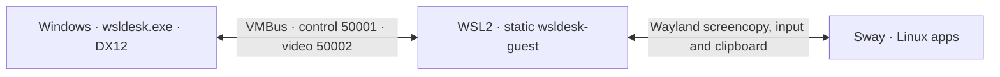

# WSLDesk

WSLDesk opens a Linux Wayland desktop from WSL2 in a native Windows Direct3D 12 window. It is a Wayland-first alternative to Win-KeX. Input and video travel over Hyper-V sockets on VMBus, so the desktop bridge requires no NAT address, port forwarding, or firewall rule.

Unfortunately performance wise it is currently a mess in a heavy prerelease state. I wouldn't recommend actually fully using it just yet. I left agent configs and more extensive read me's around architecture in case you want to contribute.


## Install and launch

From PowerShell, use a release checkout with `dist/wsldesk.exe` or build it from source first. The installer copies one executable to your user profile and adds it to your user PATH.

The [v0.2.0 preview](https://github.com/bpf00010/wsldesk/releases/tag/v0.2.0) includes
damage-only updates and an adjustable guest refresh rate. Close the old desktop
before upgrading, then run `wsldesk up` with the new executable. It installs the
matching embedded guest. Hosts and guests from v0.1.0 and v0.2.0 use different
protocol versions.

```powershell
.\scripts\install.ps1
wsldesk doctor
wsldesk setup --install-desktop
wsldesk up
```

The installer also takes `-ReleaseUrl` with an HTTPS URL to the released executable. If an existing terminal cannot find `wsldesk`, open a new terminal. Desktop package installation can take several minutes. Setup preserves an existing Sway config. Use `--distro Ubuntu` to select a named distro. `up` prepares systemd and the graphics groups, deploys the embedded guest if its checksum has changed, and selects Sway when available. Try `wsldesk up --fullscreen --width 1920 --height 1080` for a full-screen session or `--no-audio` to disable audio passthrough.

## Desktop controls

| Control | Action |
| --- | --- |
| Click inside the window | Grab keyboard shortcuts |
| Right Ctrl or Ctrl+Alt+G | Toggle keyboard grab |
| Right Ctrl + F | Toggle Windows borderless fullscreen and grab on entry |
| Win + Enter | Open foot |
| Win + B | Open Chrome on the configured Ubuntu desktop |
| Win + D | Open the application launcher |
| Win + E | Open Thunar |
| Win + Q | Close the focused Linux window |
| Win + F / Win + Space | Toggle Linux fullscreen / floating |
| Win + 1–9 / Win + Shift + 1–9 | Switch workspaces / move the focused window |
| Clipboard | Text synchronizes between Windows and Wayland |
| Audio | Uses WSL audio passthrough when available. Click the volume widget to mute |
| Wallpaper | Replace `~/.config/sway/wallpaper.png` and reload Sway |

## Architecture



## Supported distros

Ubuntu on WSL2 is the release verification target. The starter installer also recognizes Fedora (DNF), Arch (pacman), and openSUSE (zypper). Package availability depends on the distro release and enabled repositories. The interactive capture path requires a compositor with the wlroots screencopy protocol. Chrome is installed separately from its official `.deb` on the configured Ubuntu desktop.

## Build from source

Use Rust with the Windows MSVC toolchain and install the guest target with `rustup target add x86_64-unknown-linux-musl`. Run `.\scripts\build-release.ps1` to build the static Linux guest first and embed it in `dist/wsldesk.exe`. The script also writes `dist/wsldesk.exe.sha256`.

## Troubleshooting

Run `wsldesk doctor --distro Ubuntu` for WSL version, systemd, GPU, guest binary, and session checks. If no desktop is detected, run `wsldesk setup --install-desktop`. If a session uses pixman, its compositor is rendering in software. If Win shortcuts reach Windows, click inside WSLDesk and check the grab indicator in the title.


## Performance in v0.2.0

- `wsldesk up --fps 144` requests a 144 Hz guest output mode. The supported range
  is 30–240 Hz and the default is 144 Hz. Delivered frame rate depends on
  compositor load, scene damage, transport, and the Windows display.
- The guest reuses a shared-memory capture buffer and waits for Wayland damage.
  Small changes travel as dirty rectangles, and DX12 uploads just those regions.
  Resize starts with a complete frame. Where supported, DX12 prefers Mailbox
  presentation and uses nearest-neighbor sampling when frame and window sizes match.

## Roadmap

### High-Resolution (1440p / 4K) Performance & Bandwidth
- **Multi-Threaded Compression & Adaptive Quality:** Parallelize LZ4 tile compression across cores (and evaluate optional hardware/low-latency video codecs for motion-heavy workloads like browser video playback).
- **GPU-Accelerated Guest Compositing:** Investigate alternatives to the current `WLR_RENDERER=pixman` software compositing fallback (currently required because WSL2's `/dev/dri/renderD128` `dxg` DRM layer rejects `DRM_IOCTL_MODE_CREATE_DUMB` / GBM buffer allocation for headless outputs), freeing CPU headroom at high resolutions.
- **Fractional HiDPI:** Expand testing across mixed-DPI monitors and 4K displays.

### Input, Clipboard & Usability Bug Fixes
- **Lower Input Latency:** Replace the 2 ms `select()` polling interval in `ControlPump` with event-driven signaling, fix remaining modifier/grab edge cases (`Alt+Tab` and focus transitions), and add configurable grab hotkeys.
- **Richer Clipboard Sync:** Extend Win32 ↔ `zwlr_data_control_v1` beyond `text/plain;charset=utf-8` to support images (`image/png`) and richer MIME types cleanly.
- **Session Persistence & Reattach (`wsldesk attach`):** Allow detaching and reattaching the Windows viewport without killing open Linux apps, alongside graceful recovery from transient VMBus hiccups.

### Broader Desktop Environment & Compositor Support
- **GNOME (Mutter) & KDE Plasma (KWin):** Implement capture and input injection through `xdg-desktop-portal` (ScreenCast + PipeWire + RemoteDesktop portals), since Mutter and KWin do not expose `zwlr_screencopy_manager_v1` or `zwlr_virtual_pointer_v1`.
- **Standardized Wayland Capture Protocols:** Add support for upstream `ext-image-copy-capture-v1` as compositors (including Weston, COSMIC, and newer wlroots/Smithay builds) adopt it.
- **First-Class Multi-Compositor Profiles:** Tested launch presets and starter configs for Hyprland, Labwc, Wayfire, River, and Weston in addition to Sway.
- **Multi-Distro Port Isolation:** Support dynamic or configurable `AF_VSOCK` ports (beyond hardcoded `50001`/`50002`) so sessions can run across multiple WSL2 distros concurrently without hitting `EADDRINUSE` in the shared WSL2 utility VM.
