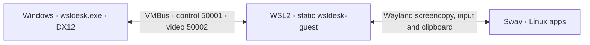

# WSLDesk

WSLDesk opens a Linux Wayland desktop from WSL2 in a native Windows Direct3D 12 window. It is a Wayland-first alternative to Win-KeX. Input and video travel over Hyper-V sockets on VMBus, so the desktop bridge requires no NAT address, port forwarding, or firewall rule.

Unfortunately performance wise it is currently a mess in a heavy prerelease state. I wouldn't recommend actually fully using it just yet. I left agent configs and more extensive read me's around architecture in case you want to contribute.


## Install and launch

From PowerShell, use a release checkout with `dist/wsldesk.exe` or build it from source first. The installer copies one executable to your user profile and adds it to your user PATH.

```powershell
.\scripts\install.ps1
wsldesk doctor
wsldesk setup --install-desktop
wsldesk up
```

The installer also takes `-ReleaseUrl` with an HTTPS URL to the released executable. If an existing terminal cannot find `wsldesk`, open a new terminal. Desktop package installation can take several minutes. Setup preserves an existing Sway config. Use `--distro Ubuntu` to select a named distro. `up` prepares systemd and the graphics groups, deploys the embedded guest if its checksum has changed, and selects Sway when available. Try `wsldesk up --fullscreen --width 1920 --height 1080` for a full-screen session or `--no-audio` to disable audio passthrough.

## Desktop controls

| Control | Action |
| --- | --- |
| Click inside the window | Grab keyboard shortcuts |
| Right Ctrl or Ctrl+Alt+G | Toggle keyboard grab |
| Right Ctrl + F | Toggle Windows borderless fullscreen and grab on entry |
| Win + Enter | Open foot |
| Win + B | Open Chrome on the configured Ubuntu desktop |
| Win + D | Open the application launcher |
| Win + E | Open Thunar |
| Win + Q | Close the focused Linux window |
| Win + F / Win + Space | Toggle Linux fullscreen / floating |
| Win + 1–9 / Win + Shift + 1–9 | Switch workspaces / move the focused window |
| Clipboard | Text synchronizes between Windows and Wayland |
| Audio | Uses WSL audio passthrough when available. Click the volume widget to mute |
| Wallpaper | Replace `~/.config/sway/wallpaper.png` and reload Sway |

## Architecture



## Supported distros

Ubuntu on WSL2 is the release verification target. The starter installer also recognizes Fedora (DNF), Arch (pacman), and openSUSE (zypper). Package availability depends on the distro release and enabled repositories. The interactive capture path requires a compositor with the wlroots screencopy protocol. Chrome is installed separately from its official `.deb` on the configured Ubuntu desktop.

## Build from source

Use Rust with the Windows MSVC toolchain and install the guest target with `rustup target add x86_64-unknown-linux-musl`. Run `.\scripts\build-release.ps1` to build the static Linux guest first and embed it in `dist/wsldesk.exe`. The script also writes `dist/wsldesk.exe.sha256`.

## Troubleshooting

Run `wsldesk doctor --distro Ubuntu` for WSL version, systemd, GPU, guest binary, and session checks. If no desktop is detected, run `wsldesk setup --install-desktop`. If a session uses pixman, its compositor is rendering in software. If Win shortcuts reach Windows, click inside WSLDesk and check the grab indicator in the title.

## Roadmap

- 144 Hz capture, `copy_with_damage`, and reusable `wl_shm` buffers.
- GNOME and KDE capture via the PipeWire desktop portal.
